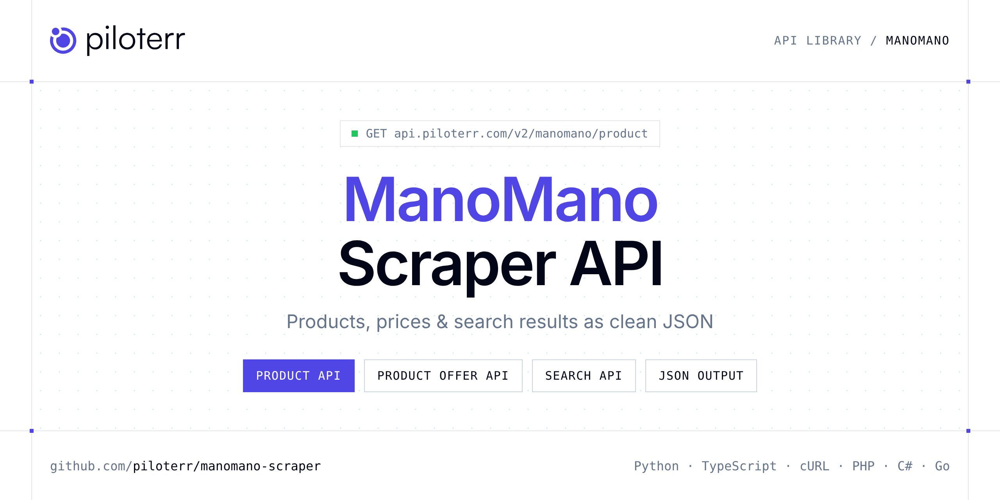

<p align="center">
  <a href="https://www.piloterr.com"></a>
</p>

# ManoMano Scraper API

[](https://discord.gg/CFj3ph8aHU) [](https://app.piloterr.com) [](https://app.piloterr.com/openapi) [](LICENSE)

The **Piloterr ManoMano Scraper API** lets you extract public data from ManoMano as **clean, structured JSON** — no proxies, headless browsers or HTML parsing to maintain. Endpoints available in production:

- **ManoMano Product API** — Read a ManoMano product URL and return the title, price, seller, and EAN.
- **ManoMano Product Offer API** — List the other sellers for a ManoMano product id.
- **ManoMano Search API** — Read a ManoMano category or search URL and return product cards with price and pagination.

Use it for price monitoring, assortment tracking, competitor analysis, product research or catalog enrichment.

| Endpoint | Path | Credits | What you get |
|---|---|---|---|
| [ManoMano Product API](#manomano-product-api) | `/v2/manomano/product` | 2 | Read a ManoMano product URL and return the title, price, seller, and EAN. |
| [ManoMano Product Offer API](#manomano-product-offer-api) | `/v2/manomano/product/offer` | 1 | List the other sellers for a ManoMano product id. |
| [ManoMano Search API](#manomano-search-api) | `/v2/manomano/search` | 2 | Read a ManoMano category or search URL and return product cards with price and pagination. |

## Table of contents

- [How it works](#how-it-works)
- [ManoMano Product API](#manomano-product-api)
- [ManoMano Product Offer API](#manomano-product-offer-api)
- [ManoMano Search API](#manomano-search-api)
- [Code examples in other languages](#code-examples-in-other-languages)
- [Practical use cases](#practical-use-cases)
- [Why Piloterr?](#why-piloterr)
- [FAQ](#faq)
- [Related scrapers](#related-scrapers)
- [Support](#support)

## How it works

1. **Create a free Piloterr account** and copy your API key from the [dashboard](https://app.piloterr.com).
2. **Send a `GET` (or `POST`) request** to `https://api.piloterr.com/v2/...` with the header `x-api-key: YOUR_API_KEY`.
3. **Receive structured JSON** — Piloterr handles rendering, proxies, retries and parsing.

```bash
export PILOTERR_API_KEY="your-api-key"
pip install requests        # Python
# TypeScript: Node.js 18+ (native fetch), run with `npx tsx file.ts`
```

> Every endpoint accepts both `GET` (query string) and `POST` (JSON body with the same fields).

## ManoMano Product API

Read a ManoMano product URL and return the title, price, seller, and EAN.

`GET | POST https://api.piloterr.com/v2/manomano/product` · **2 credits per request** · [Full reference](https://app.piloterr.com/openapi)

### Request parameters

| Parameter | Type | Required | Description |
|---|---|---|---|
| `query` | string | ✅ | Full ManoMano product page URL. Optionally include the `model_id` query parameter to target a specific variant. |

### Python example

```python
import json
import os
import requests

response = requests.get(
    "https://api.piloterr.com/v2/manomano/product",
    headers={"x-api-key": os.environ["PILOTERR_API_KEY"]},
    params={
        "query": "https://www.manomano.fr/p/pergola-retractable-298l-x-213l-x-222h-m-structure-metal-epoxy-anticorrosion-toile-polyester-haute-densite-180-g-m-incluse-gris-17786586?model_id=17784588",
    },
    timeout=120,
)
response.raise_for_status()
data = response.json()

print(json.dumps(data, indent=2, ensure_ascii=False)[:2000])
```

### TypeScript example

```typescript
type ManomanoProduct = {
  ean?: string;
  url?: string;
  brand?: string;
  image?: string;
  mm_id?: number;
  price?: number;
  title?: string;
  images?: string[];
  brand_id?: number;
  currency?: string;
  in_stock?: boolean;
  model_id?: number;
  offer_id?: string;
  brand_url?: string;
  seller_id?: number;
  article_id?: number;
  product_id?: number;
  description?: string;
  seller_name?: string;
  price_display?: string;
  original_price?: number;
  seller_country?: string;
  discount_percentage?: number;
  other_sellers_count?: number;
  original_price_display?: string;
};

const params = new URLSearchParams({
  "query": "https://www.manomano.fr/p/pergola-retractable-298l-x-213l-x-222h-m-structure-metal-epoxy-anticorrosion-toile-polyester-haute-densite-180-g-m-incluse-gris-17786586?model_id=17784588",
});

const response = await fetch(`https://api.piloterr.com/v2/manomano/product?${params}`, {
  headers: { "x-api-key": process.env.PILOTERR_API_KEY! },
});
if (!response.ok) throw new Error(`Piloterr error ${response.status}: ${await response.text()}`);

const data = (await response.json()) as ManomanoProduct;

console.log(JSON.stringify(data, null, 2).slice(0, 2000));
```

<details>
<summary><b>POST variant</b></summary>

```http
POST https://api.piloterr.com/v2/manomano/product
x-api-key: YOUR_API_KEY
Content-Type: application/json

{"query": "https://www.manomano.fr/p/pergola-retractable-298l-x-213l-x-222h-m-structure-metal-epoxy-anticorrosion-toile-polyester-haute-densite-180-g-m-incluse-gris-17786586?model_id=17784588"}
```
</details>

### Output example

Example response from the API reference, abridged — real values depend on the page you scrape.

```json
{
  "ean": "0088381804882",
  "url": "https://www.manomano.fr/p/perceuse-visseuse-lxt-makita-18-v-3-ah-84523637?product_id=158588345",
  "brand": "MAKITA",
  "image": "https://cdn.manomano.com/pim-media/images/large/9c7e21d66ddc6c646bd8aab8aa145e620dcb2cac.jpg",
  "mm_id": 266848842586,
  "price": 214.96,
  "title": "Makita – Perceuse-visseuse 18V DDF482SFE – 2 batteries 3Ah – Moteur Brushless – Couple 64Nm – Coffret avec chargeur",
  "images": [
    "https://cdn.manomano.com/pim-media/images/large/9c7e21d66ddc6c646bd8aab8aa145e620dcb2cac.jpg"
  ],
  "brand_id": 16,
  "currency": "EUR",
  "in_stock": true,
  "model_id": 89580210,
  "offer_id": "f85116da-cfef-4467-8e38-a71a5b08aa37",
  "brand_url": "https://www.manomano.fr/marque/makita-16",
  "seller_id": 12,
  "article_id": 84523637,
  "product_id": 158588345,
  "description": "Description générale La perceuse visseuse 18V 3Ah DDF482SFE de Makita est un outil puissant et compact, idéal pour les travaux quotidiens…",
  "seller_name": "example",
  "price_display": "214,96 €",
  "original_price": 385.55,
  "seller_country": "FR",
  "discount_percentage": 44,
  "other_sellers_count": 6,
  "original_price_display": "385,55 €"
}
```

### Response fields

| Field | Type | Description |
|---|---|---|
| `ean` | string |  |
| `url` | string |  |
| `brand` | string |  |
| `image` | string |  |
| `mm_id` | integer |  |
| `price` | number |  |
| `title` | string |  |
| `images` | string[] |  |
| `brand_id` | integer |  |
| `currency` | string |  |
| `in_stock` | boolean |  |
| `model_id` | integer |  |
| `offer_id` | string |  |
| `brand_url` | string |  |
| `seller_id` | integer |  |
| `article_id` | integer |  |
| `product_id` | integer |  |
| `description` | string |  |
| `seller_name` | string |  |
| `price_display` | string |  |
| `original_price` | number |  |
| `seller_country` | string |  |
| `discount_percentage` | integer |  |
| `other_sellers_count` | integer |  |
| `original_price_display` | string |  |

## ManoMano Product Offer API

List the other sellers for a ManoMano product id.

`GET | POST https://api.piloterr.com/v2/manomano/product/offer` · **1 credit per request** · [Full reference](https://app.piloterr.com/openapi)

### Request parameters

| Parameter | Type | Required | Description |
|---|---|---|---|
| `query` | string | ✅ | ManoMano product ID. This is the numeric `product_id` returned by the ManoMano Product endpoint. |
| `region` | string | ✅ | Region code for the ManoMano platform. Must match the original product's domain. |

### Python example

```python
import json
import os
import requests

response = requests.get(
    "https://api.piloterr.com/v2/manomano/product/offer",
    headers={"x-api-key": os.environ["PILOTERR_API_KEY"]},
    params={
        "query": "28910102",
        "region": "FR",
    },
    timeout=120,
)
response.raise_for_status()
data = response.json()

print(json.dumps(data, indent=2, ensure_ascii=False)[:2000])
```

### TypeScript example

```typescript
type ManomanoProductOffer = {
  count?: number;
  results?: {
    sku?: {
      title?: string;
    };
    price?: number;
    market?: string;
    seller?: {
      is_m_f?: boolean;
      contract_id?: string;
    };
    product_id?: string;
    is_sellable?: boolean;
    price_display?: string;
  }[];
};

const params = new URLSearchParams({
  "query": "28910102",
  "region": "FR",
});

const response = await fetch(`https://api.piloterr.com/v2/manomano/product/offer?${params}`, {
  headers: { "x-api-key": process.env.PILOTERR_API_KEY! },
});
if (!response.ok) throw new Error(`Piloterr error ${response.status}: ${await response.text()}`);

const data = (await response.json()) as ManomanoProductOffer;

console.log(JSON.stringify(data, null, 2).slice(0, 2000));
```

<details>
<summary><b>POST variant</b></summary>

```http
POST https://api.piloterr.com/v2/manomano/product/offer
x-api-key: YOUR_API_KEY
Content-Type: application/json

{"query": "28910102", "region": "FR"}
```
</details>

### Output example

Example response from the API reference, abridged — real values depend on the page you scrape.

```json
{
  "count": 6,
  "results": [
    {
      "sku": {
        "title": "Makita – Perceuse-visseuse 18V DDF482SFE"
      },
      "price": 214.96,
      "market": "B2C",
      "seller": {
        "is_m_f": false,
        "contract_id": "example"
      },
      "product_id": "359528470",
      "is_sellable": true,
      "price_display": "214,96 €"
    }
  ]
}
```

### Response fields

| Field | Type | Description |
|---|---|---|
| `count` | integer |  |
| `results[]` | object[] |  |
| `results[].sku` | object |  |
| `results[].price` | number |  |
| `results[].market` | string |  |
| `results[].seller` | object |  |
| `results[].product_id` | string |  |
| `results[].is_sellable` | boolean |  |
| `results[].price_display` | string |  |

## ManoMano Search API

Read a ManoMano category or search URL and return product cards with price and pagination.

`GET | POST https://api.piloterr.com/v2/manomano/search` · **2 credits per request** · [Full reference](https://app.piloterr.com/openapi)

### Request parameters

| Parameter | Type | Required | Description |
|---|---|---|---|
| `query` | string | ✅ | Full ManoMano search or category page URL. |

### Python example

```python
import json
import os
import requests

response = requests.get(
    "https://api.piloterr.com/v2/manomano/search",
    headers={"x-api-key": os.environ["PILOTERR_API_KEY"]},
    params={
        "query": "https://www.manomano.fr/perceuse-1146",
    },
    timeout=120,
)
response.raise_for_status()
data = response.json()

print(json.dumps(data, indent=2, ensure_ascii=False)[:2000])
```

### TypeScript example

```typescript
type ManomanoSearch = {
  results?: {
    url?: string;
    brand?: string;
    is_mf?: boolean;
    price?: number;
    title?: string;
    is_pro?: boolean;
    rating?: number;
    currency?: string;
    in_stock?: boolean;
    model_id?: string;
    seller_id?: string;
    article_id?: string;
    product_id?: string;
    seller_name?: string;
    rating_count?: number;
    price_display?: string;
    delivery_label?: string;
    original_price?: number;
    discount_percentage?: number;
    original_price_display?: string;
  }[];
  pagination?: {
    next?: string;
    page?: number;
    per_page?: number;
    total_pages?: number;
    total_results?: number;
  };
};

const params = new URLSearchParams({
  "query": "https://www.manomano.fr/perceuse-1146",
});

const response = await fetch(`https://api.piloterr.com/v2/manomano/search?${params}`, {
  headers: { "x-api-key": process.env.PILOTERR_API_KEY! },
});
if (!response.ok) throw new Error(`Piloterr error ${response.status}: ${await response.text()}`);

const data = (await response.json()) as ManomanoSearch;

console.log(JSON.stringify(data, null, 2).slice(0, 2000));
```

<details>
<summary><b>POST variant</b></summary>

```http
POST https://api.piloterr.com/v2/manomano/search
x-api-key: YOUR_API_KEY
Content-Type: application/json

{"query": "https://www.manomano.fr/perceuse-1146"}
```
</details>

### Output example

Example response from the API reference, abridged — real values depend on the page you scrape.

```json
{
  "results": [
    {
      "url": "https://www.manomano.fr/p/perceuse-visseuse-lxt-makita-18-v-3-ah-84523637?product_id=158588345",
      "brand": "MAKITA",
      "is_mf": false,
      "price": 214.96,
      "title": "Makita – Perceuse-visseuse 18V DDF482SFE – 2 batteries 3Ah – Moteur Brushless – Couple 64Nm – Coffret avec chargeur",
      "is_pro": false,
      "rating": 4.57,
      "currency": "EUR",
      "in_stock": true,
      "model_id": "89580210",
      "seller_id": "12",
      "article_id": "84523637",
      "product_id": "158588345",
      "seller_name": "example",
      "rating_count": 7,
      "price_display": "214,96 €",
      "delivery_label": "Livraison gratuite",
      "original_price": 385.55,
      "discount_percentage": 44,
      "original_price_display": "385,55 €"
    }
  ],
  "pagination": {
    "next": "https://www.manomano.fr/perceuse-1146?page=2",
    "page": 1,
    "per_page": 56,
    "total_pages": 100,
    "total_results": 6000
  }
}
```

### Response fields

| Field | Type | Description |
|---|---|---|
| `results[]` | object[] |  |
| `results[].url` | string |  |
| `results[].brand` | string |  |
| `results[].is_mf` | boolean |  |
| `results[].price` | number |  |
| `results[].title` | string |  |
| `results[].is_pro` | boolean |  |
| `results[].rating` | number |  |
| `results[].currency` | string |  |
| `results[].in_stock` | boolean |  |
| `results[].model_id` | string |  |
| `results[].seller_id` | string |  |
| `results[].article_id` | string |  |
| `results[].product_id` | string |  |
| `results[].seller_name` | string |  |
| `results[].rating_count` | integer |  |
| `results[].price_display` | string |  |
| `results[].delivery_label` | string |  |
| `results[].original_price` | number |  |
| `results[].discount_percentage` | integer |  |
| `results[].original_price_display` | string |  |
| `pagination` | object |  |
| `pagination.next` | string |  |
| `pagination.page` | integer |  |
| `pagination.per_page` | integer |  |

## Code examples in other languages

Ready-to-run examples live in the [`examples/`](examples) folder. Each one reads your key from the `PILOTERR_API_KEY` environment variable.

| Language | Product | Product Offer | Search |
|---|---|---|---|
| cURL (Bash) | [`product`](examples/curl/product.sh) | [`product-offer`](examples/curl/product_offer.sh) | [`search`](examples/curl/search.sh) |
| PHP | [`product`](examples/php/product.php) | [`product-offer`](examples/php/product_offer.php) | [`search`](examples/php/search.php) |
| C# | [`product`](examples/csharp/Product.cs) | [`product-offer`](examples/csharp/ProductOffer.cs) | [`search`](examples/csharp/Search.cs) |
| Go | [`product`](examples/go/product.go) | [`product-offer`](examples/go/product_offer.go) | [`search`](examples/go/search.go) |
| Java | [`product`](examples/java/ProductExample.java) | [`product-offer`](examples/java/ProductOfferExample.java) | [`search`](examples/java/SearchExample.java) |
| Ruby | [`product`](examples/ruby/product.rb) | [`product-offer`](examples/ruby/product_offer.rb) | [`search`](examples/ruby/search.rb) |
| Node.js | [`product`](examples/nodejs/product.mjs) | [`product-offer`](examples/nodejs/product_offer.mjs) | [`search`](examples/nodejs/search.mjs) |

## Practical use cases

- **Price monitoring** — Track prices, promotions and availability over time to react to competitors.
- **Assortment & catalog tracking** — Follow new products, delisted items and category changes.
- **Competitor analysis** — Benchmark ranges, brands and positioning across retailers.
- **Product research** — Spot best-sellers and trends from search results.
- **Catalog enrichment** — Pull titles, images and attributes into your PIM or marketplace listings.

## Why Piloterr?

- **No infrastructure** — no proxies, headless browsers or CAPTCHA solving to run yourself.
- **Structured JSON** — stable, documented fields instead of brittle HTML selectors.
- **Pay per request** — transparent credit cost per endpoint, failed requests are retried for you.
- **One API key, hundreds of sources** — ManoMano plus many other e-commerce, search and company data endpoints in the [Piloterr library](https://www.piloterr.com/library).
- **Any language** — plain HTTPS + JSON, with examples for Python, TypeScript, cURL, PHP, C#, Go, Java, Ruby and Node.js.

## FAQ

### Is it legal to scrape ManoMano?

Collecting publicly available data is generally allowed in many jurisdictions, but rules depend on your country, the data you collect and how you use it. Avoid personal data unless you have a lawful basis, respect the website's terms where they apply, and get legal advice for your specific use case. This is not legal advice.

### Do I need proxies or a headless browser?

No. Piloterr handles rendering, proxy rotation and retries on its side. You only send an HTTPS request with your `x-api-key` header and receive JSON.

### How much does a request cost?

Credits per call: `/v2/manomano/product` **2**, `/v2/manomano/product/offer` **1**, `/v2/manomano/search` **2**. See the [Piloterr website](https://www.piloterr.com) for plans.

### What data does the ManoMano API return?

Each endpoint returns structured JSON: **ManoMano Product** — `ean`, `url`, `brand`, `image`, `mm_id`, `price`; **ManoMano Product Offer** — `count`, `results[]`, `results[].sku`, `results[].price`, `results[].market`, `results[].seller`; **ManoMano Search** — `results[]`, `results[].url`, `results[].brand`, `results[].is_mf`, `results[].price`, `results[].title`.

### Can I target a specific country or language?

Yes, use `region` — see the parameter tables above for accepted values.

### Which languages are supported?

Any language that can make an HTTP request. This README shows Python and TypeScript; the [`examples/`](examples) folder contains cURL, PHP, C#, Go, Java, Ruby and Node.js.

## Related scrapers

- [About You Scraper API](https://github.com/piloterr/aboutyou-scraper)
- [Action Scraper API](https://github.com/piloterr/action-scraper)
- [Aldi Scraper API](https://github.com/piloterr/aldi-scraper)
- [Alibaba Scraper API](https://github.com/piloterr/alibaba-scraper)
- [AliExpress Scraper API](https://github.com/piloterr/aliexpress-scraper)
- [Allegro Scraper API](https://github.com/piloterr/allegro-scraper)
- [All Piloterr scrapers on GitHub](https://github.com/piloterr)

## Support

- 💬 Join the [Piloterr Discord](https://discord.gg/CFj3ph8aHU) to ask questions and share what you build.
- 📚 Browse the [API reference (OpenAPI)](https://app.piloterr.com/openapi) and the [Piloterr library](https://www.piloterr.com/library).
- 🔑 [Get your API key](https://app.piloterr.com).

---

<p align="center">
  <a href="https://www.piloterr.com">
    <picture>
      <source media="(prefers-color-scheme: dark)" srcset="images/logo-dark.svg">
      
    </picture>
  </a>
  <br>
  <sub>Built by <a href="https://www.piloterr.com">Piloterr</a> — web scraping APIs for e-commerce, search, real estate and more, one API key.</sub>
</p>

<sub>ManoMano is a trademark of its respective owner. This repository is not affiliated with or endorsed by ManoMano. Examples are released under the MIT license.</sub>
